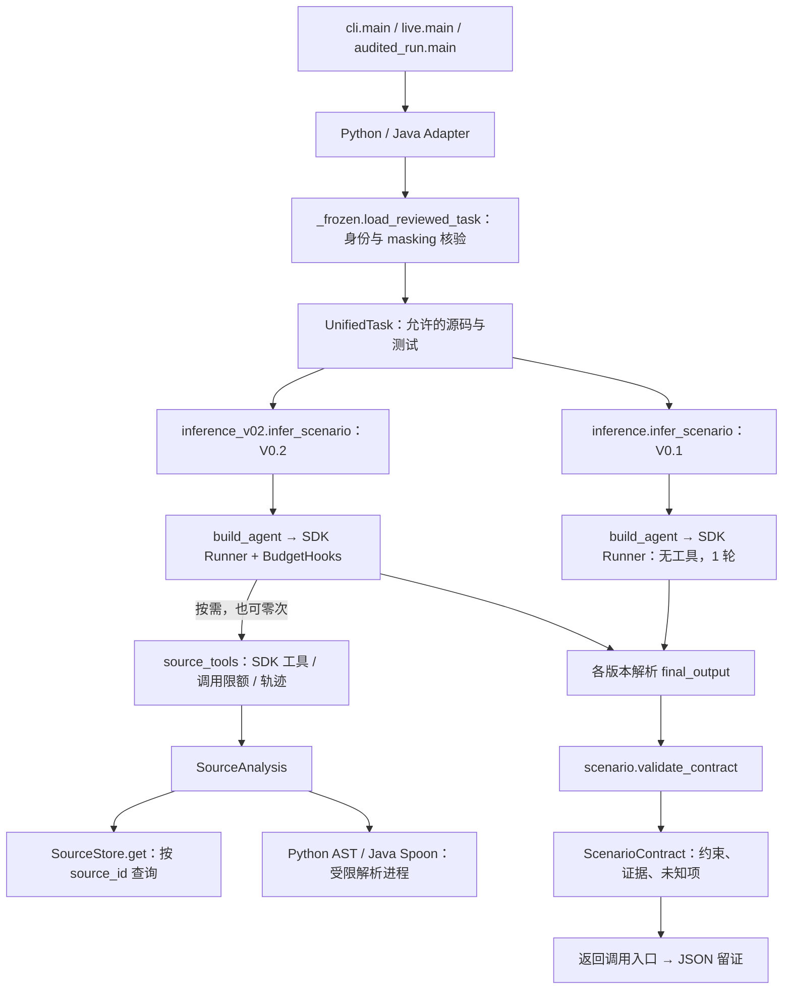

# Scenario Agent 架构导读

[项目入口](../README.md) · [运行命令](usage.md) · [输出字段](scenario-inference.md) · [研究与历史](README.md)

## 先认识四个文件

理解 V0.2 时先读这四处，暂时不需要阅读实验脚本和账本：

| 阅读顺序 | 文件及位置 | 回答的问题 |
| --- | --- | --- |
| 1 | [scenario_v0.2.txt](../src/mock_spec/prompts/scenario_v0.2.txt) | 要模型从输入推导什么？如何表达条件、替代解释和未知项？ |
| 2 | [scenario.py](../src/mock_spec/scenario.py)：`ScenarioContract` | 最终交付哪些约束和证据？ |
| 3 | [inference_v02.py](../src/mock_spec/inference_v02.py)：`build_agent`、`infer_scenario` | 如何组装并运行模型、Prompt、工具和输出类型？ |
| 4 | [source_analysis.py](../src/mock_spec/source_analysis.py)：`SourceAnalysis` | 模型需要更多证据时能查什么？ |

这里的 Agent 是“模型 + Prompt + 只读工具 + 结构化输出”。
Python 宿主负责运行和验证；场景推导主要由模型完成，并没有一套完整的确定性推导算法。

V0.2 的代码职责现在按下面的关系组织；先读中间的推断入口，需要细节时再向两侧展开：

```text
budget.py                  inference_v02.py               source_tools.py
预算定义、用量和门禁  ←  加载 Prompt → 组装 → 运行 → 校验  →  三个 SDK 工具及任务级轨迹
                                                              ↓
                                                        source_analysis.py
                                                        可见源码与语法事实
```

`source_tools.build_source_tools` 接收本次运行的 `SourceStore`，在 SDK 参数解析前登记原始请求、
响应关联及失败；它不负责推断。默认片段模式保留原调用限额。显式仓库读取模式不设固定工具或
SDK 轮数上限，由运行超时与共享用量账本停止。
`InferenceBudget` 定义在 `budget.py`，原 `inference_v02.InferenceBudget` 导入仍可用。

## 一次输入如何流动



图中入口按版本选择其中一条推断路径，不会同时调用两版。
`cli --response-json` 是另一条明确的离线分支：Adapter → 契约校验 → synthetic_replay，绕过模型。

1. **输入审核**：宿主提供 snapshot 和 case ID。Adapter 检查已安装准入记录、文件身份和 masking，产出 `UnifiedTask`。
2. **推断**：`infer_scenario` 将 `task.to_dict()` 作为初始输入。`build_agent` 配置对应 Prompt、模型、工具与 `output_type=ScenarioContract`。
3. **工具查询**：V0.2 可以查询原文、程序结构和依赖使用。默认工具分析当前任务可见片段；仓库读取模式允许 `inspect_source` 的 `source_id` 参数
   使用初始逻辑路径或已发现路径读取更多行，返回稳定的动态 source_id。
   `inspect_source` 的 `search` 操作在宿主绑定的冻结项目内按相对路径模式/字面文本发现文件，
   生产 SDK 和研究 QueryExecutor 使用同一参数校验与 SourceAnalysis/SourceStore 实现。
   搜索只登记实际返回的完整匹配行，路径发现与内部读取不授权全文引用。分析失败或未解析状态保留。
   两个分析工具共用 `source_id` 与可选 `symbol` 协议；初始 ID 分析原片段，已发现 ID/路径
   经 Store 内部有界读取完整文件后复用 AST/Spoon。定义与使用位置按精度分类，名称匹配不等于目标解析。
   仓库模式分析不返回引用原文或登记 observed，需显式读取对应行后才能引用。
4. **输出验证**：模型返回候选契约；宿主使用同一运行 Store 检查结构、任务身份、初始或实际观察引用、源码行范围和原文。引用存在不意味着结论成立。
   宿主审核记录可用 `repository_excluded_paths` 排除精确文件或目录子树；该限制在搜索遍历、
   直接读取和分析读取前执行并绑定分页身份，不进入 UnifiedTask。当前用于 CloudFoundry 案例的
   准备材料、构建产物及依赖环境隔离，已有案例默认范围不变。
5. **保存结果**：CLI 写简单 JSON；完整审计入口额外保存身份、原始响应、轨迹、用量和失败状态。

## 文件地图

这些是现有文件的职责分组，不是新增的目录或调用层级。

| 职责 | 现有文件 | 何时阅读 |
| --- | --- | --- |
| 审核输入 | [adapters/](../src/mock_spec/adapters/)、[schemas.py](../src/mock_spec/schemas.py)、[validation.py](../src/mock_spec/validation.py)、[reviewed_inputs.json](../src/mock_spec/reviewed_inputs.json) | 修改输入准入、源码范围或 SourceStore 时 |
| Agent 核心 | [inference.py](../src/mock_spec/inference.py)、[inference_v02.py](../src/mock_spec/inference_v02.py)、[prompts/](../src/mock_spec/prompts/)、[scenario.py](../src/mock_spec/scenario.py) | 理解或修改场景推断与输出处理时 |
| SDK 工具接入 | [source_tools.py](../src/mock_spec/source_tools.py) | 核对模型可见工具定义、任务级调用限额、轨迹与取消行为时 |
| 宿主文件绑定 | [source_repository.py](../src/mock_spec/source_repository.py) | 描述符相对读取、有界搜索、访问策略、分页及文件身份核验；绑定不进入 UnifiedTask |
| 源码工具 | [source_analysis.py](../src/mock_spec/source_analysis.py)、[python_analysis.py](../src/mock_spec/python_analysis.py)、[java_analysis.py](../src/mock_spec/java_analysis.py) | 核对可见源码与语法事实时 |
| 解析进程 | [analysis_process.py](../src/mock_spec/analysis_process.py)、[python_analysis_runner.py](../src/mock_spec/python_analysis_runner.py)、[tools/](../src/mock_spec/tools/) | 检查超时、取消、隔离与 Java helper 时 |
| 运行入口 | [cli.py](../src/mock_spec/cli.py)、[live.py](../src/mock_spec/live.py)、[audited_run.py](../src/mock_spec/audited_run.py) | 启动推断或选择留证方式时 |
| 执行元数据 | [execution_metadata.py](../src/mock_spec/execution_metadata.py) | 核对代码版本、指纹、运行环境及不可用状态时 |
| 预算与留证 | [budget.py](../src/mock_spec/budget.py)、[experiment_ledger.py](../src/mock_spec/experiment_ledger.py)、[run_evidence.py](../src/mock_spec/run_evidence.py) | 核对预算门禁、实验尝试和结果写入时 |

`execution_metadata.collect_execution_metadata` 统一采集代码版本、文件指纹与运行环境；
审计入口和离线验证脚本都使用这个接口，不再从运行入口导入私有函数。
它不负责推断或写入证据，输出字段由调用者映射到各自已有格式。

`audited_run.main` 在正式运行前登记尝试，推断后交给 `run_evidence.finish_run`。
有账本时先写 pending 证据，再完成账本，最后发布结果；失败时保留可得证据。
这些是宿主的运行管理，不是模型的推断步骤。

V0.2 用 `InferenceTimeoutError` 区分宿主总超时与其他预算耗尽；它仍继承共享
`InferenceError`，保留原 `category` 与 `diagnostic`。`audited_run` 将超时事实交给
`finish_run` 决定账本 outcome，结果 JSON 的原有字段不增加、不改义。
V0.1 的冻结异常没有这个类型，历史文案识别只保留在审计入口的 V0.1 分支。
留证 module 不再根据异常文字分类，也不依赖具体版本的推断实现。

完整实现身份记录在 `code_files_sha256`，包含工具注册模块；`code_sha256` 仅标识所选推断入口文件。
代码整理会改变正式运行的配置摘要，不能沿用旧账本伪装为同一实验，也不改写历史证据。

`live_v02.py` 仅保留 `main` 和模块命令兼容，供历史 Step 6 协议引用；当前入口是
`audited_run.py`。历史复现引用仍存在期间保留旧命令，不在兼容文件中添加实现。

## 版本与入口

| 入口 | 版本 | 用途 |
| --- | --- | --- |
| `mock-spec-scenario` / `python -m mock_spec.cli` | 默认 V0.1，可显式 V0.2 | 普通推断或显式离线回放 |
| `python -m mock_spec.audited_run` | 必须显式选择 V0.1 / V0.2 | 完整留证，区分 standalone 与正式实验账本 |
| `python -m mock_spec.live` | 仅 V0.1 | 保留早期留证协议与复现命令 |

V0.1 无工具，V0.2 有三个只读工具；两版都使用正式 ScenarioContract。
[Step 6 已确认的约定](step6/decisions.md#保留与范围)要求 V0.1 核心逐字冻结，
因此两版之间少量重复处理是保留基线的代价，不能把 `inference.py` 当成死代码删除。
旧入口仍有测试和历史复现用途。V0.1 保持冻结；V0.2 入口和预算的兼容导入保留，
内部预算定义与工具注册已按职责迁移，不再在推断入口重复保留实现。

## 命名迁移与保留的依赖

当前 `source_tools.build_source_tools` 负责 SDK 工具注册、调用限额、轨迹与取消；
`source_analysis.SourceAnalysis` 负责审核源码访问、解析后端选择与结果限长，不依赖 Agent SDK。
两个解析 adapter 的共同结果在这里校验：状态、facts 及其 kind、诊断和限制说明必须具有合法形状，
结果须能序列化为 JSON；任一共同字段畸形都整份返回 `analysis_error`，不保留部分 facts。
语言特有字段和正常诊断内容保留；取消仍向上传播，语法 incomplete/unresolved 不转为成功。
原 `agent_tools.py`、`program_tools.py` 的活动调用者已迁移，旧模块不再保留；
历史报告中的路径和哈希仍描述当时版本，复现历史版本需使用其记录的提交。
模型可见的三个 `inspect_*` 工具名称保持不变；`inspect_source` 支持显式 search/read，
原三参数读取仍兼容。畸形后端结果在两个分析查询中一致失败。

尚保留一项跨版本耦合：V0.2、预算、SDK 工具和运行留证使用冻结
`inference.py` 定义的 `InferenceError`，以保持同一个异常类型及捕获行为。
这使这些模块仍依赖 V0.1 模块；另建转发文件不能消除依赖。
待 V0.1 冻结约定允许调整公共错误归属时，再一起迁移定义、生产者和捕获者，
验证类型兼容及失败分类；本轮不修改冻结文件。

## 研究路径

`experiments/mockbench-study/` 是完整 MockBench 的独立研究入口：
冻结 agent validation reports＋正式索引 → `inventory.py` 全量清单 →
`batch.check_inputs` → `adapters/frozen_dataset.py` → 目标测试、源码访问接口与逐例加载报告。
`FrozenDataset` 沿用用户指定的上游冻结准备协议，不依赖三例白名单；`FrozenCase` 校验
控制身份、完整 masked test 和 injector，按需读取源码时核对已有 manifest 摘要。
未请求 MUT 时不构造 `UnifiedTask`；宿主选择 MUT 路径后由 `to_task` 生成已有契约输入。
不会将 masked test 伪装成 MUT，也不会从 gold 定位。`FrozenCase` 用上下文管理器关闭文件描述符。
旧 `batch` 语法基线只接收 `--input-policy reviewed` 产生的三例策略清单；它继续复用
原 Adapter 和 `SourceAnalysis`，作为历史对照保留，不能把全量输入误判为旧目录未准入。
当前不运行模型、目标测试或完整关系恢复，语义正确性保持未评价。
技术路线由后续失败分类与对照结果决定，不预先绑定 WALA 或完整符号执行。
详细边界见[研究框架](../experiments/mockbench-study/README.md)，命令见
[全量清单与批处理](usage.md#完整-mockbench-研究框架)。生产代码不反向依赖这一入口。

目标导向候选切片入口是 `experiments/backward-slicing/batch_slice.py`：同一冻结清单
→ `criteria.py` 定位目标测试与观察准则 → `source_selection.py` 按可见导入/加载路径
有界选源码 → Python AST / 固定 Spoon 后向候选图 → 每准则闭包、源码身份与逐例失败。
它复用历史 `python_probe.py` / `SliceProbe.java`，不调用后来的 GoalIR 符号解释器。
批处理的 Python 配置排除普通语句前驱边，避免把所有先前语句当作数据依赖；占位方法保持
opaque，不能把占位异常当真实效果。调用、数据及词法控制边仍是候选，未实现完整
SDG、heap/异常流或路径可行性，也未确认哪些未知调用必然属于 Mock。
未解析、预算不足、构图失败和超时保留在全量分母；协议与运行解释见
[候选切片研究入口](../experiments/backward-slicing/README.md#全量候选切片入口2026-11-09)。

同一批入口以`--semantic-gate`启用正式修复研究：先核对#30验收及r3的165个冻结身份，
每例保留候选诊断，再调用各语言`batch_semantic_backend.py`。
Java桥验证当前Jib源码与自动观察适配，重新运行WALA按需分析；Python桥验证当前
Flask／langflow输入，重新运行对应CodeQL分析。桥输出必须匹配当前案例的身份、mask和selector；
Jib历史描述身份到FrozenCase身份的投影单列收据，不在汇总时静默改写。
支持范围外的案例明确记录`unsupported`，同时保留候选构图失败与未知；
三个特定输入适配器不构成通用Java/Python语义后端。进程隔离、并发预算及逐例落盘由既有批处理负责。
生产进程的环境清理保持不变；研究Python桥仅向可信CodeQL驱动显式设置locale和系统PATH，
以支持其解释器及多进程工具启动。该边界已经用相同受限入口的双案例并发运行验证。

通用接入研究由同一入口的 `--backend-mode generic` 分派到两种语言的
`generic_backend.py`，使用原冻结清单而不通过三例 Case ID 白名单。候选诊断仍单独保留。
Python 的固定 CodeQL 值流和效果查询共用一个数据库，接收原观察位置和审核来源事实；导入与 loader 绑定
属于前端证据，与后端测试内值流组合时明确标注来源，不执行 loader。选源优先考虑
原观察及其赋值来源、相关调用和加载路径；显式导入的本地 loader 实现单列为
`loader_support`，选中辅助文件本身不证明它加载了目标函数。
Java 的 `JavaTypeConstraints.java` 用 JDK 编译器 API 查询已选源码及锁定 classpath：
按接收者、构造器、继承成员和已知实参约束缺失声明，记录使用位置、声明者与签名；
不再以无依据的 `Object` 参数或错误文本推定类型。无法唯一确定的结构类型保留未知。
编译禁用注解处理器，恢复的参数没有 Mock 行为。每个原准则按种类验证精确调用种子，
候选事件不套用外层断言。重复或不支持的种子保留逐观察边界；可支持查询独立进入共享图阶段，
使用 NO_HEAP 数据依赖及 FULL 控制依赖，每根独立切片并原子落盘。效果处理前保持可支持查询
的索引与身份，最终按原准则顺序合并失败与结果，不让预检失败压制其它根。
随后对观察直接读取的实例字段按需启动隔离 JVM，使用 FULL heap 路径及 ModRef
字段身份形成状态 may 证据；静态字段、getter 返回及间接／phi 读取仍明确未建模。
效果阶段的超时、内存失败或根错误保留逐观察前沿及成本，不丢弃基础阶段已完成的根，
合并时核验原根索引、查询与 checkpoint 摘要。类型化路径及产品 return／guard／throw
仍受上下文与路径可行性限制；缺少 heap 路径的写入只作为见证，占位方法影响保持未知。
输入准备、数据库／调用图、
观察映射、产品绑定及观察关联的跨源影响分开统计；新关系保持未核验。
当前进展与最终运行状态见[通用接入研究](../experiments/backward-slicing/README.md)。

单案例结果另附 `result_contract.py` 定义的 `mock-spec.backward-analysis-case/v1`：
冻结身份、逐观察位置、入口来源、类型化关系覆盖、未知／未分析边界、核验状态和成本。
旧候选图仍按原 profile 解读，不会因增加结果契约而成为已核验的语义关系。
关系可附 `observation_ids` 关联已登记观察；校验器拒绝未知或重复引用。
空列表表示尚未关联到原始观察，不能据内部关系推定该观察的依赖已恢复。
`compare_runs.py`仅比较已保存结果，按dataset、Case ID及snapshot固定全量分母，
保留逐例证据与未知／失败；没有记录的旧指标不推算为零，也不把覆盖标签变化认作语义改善。
当前 backend_total 包含解析、构图与切片；独立阶段未计量时明确记录原因。
Java 绑定区分静态类型访问与普通接收者，保留签名未知和参数源码位置回退的精度。
Python 在受支持的静态 Path 与直线加载代码中，连接读取文本、截取区间、compile／exec
命名空间、函数定义和测试调用变量；动态键、重绑定或无法证明文本来源时保留未知。
这些入口关系不构成完整 heap／异常依赖分析，后端能力验证仍在独立研究路径进行。
通用 Python 驱动的 `observation-effects.ql` 连接已核验调用、实际参数／形式参数、
产品可见字段写入、正常返回及原观察读取；`effect_projection.py` 分别发布状态候选、
未知依赖的 may-effect 与确定覆盖排除。精确源码列参与身份，原始协程、重绑定、
测试／loader 辅助函数及无法证明的异常类型兼容不能获得产品效果信用。
覆盖排除要求最后相关写入支配观察且写入值独立；条件写入、恢复旧值及潜在别名恢复仍保留未知。
发布上限按原观察均衡分配，省略数量和受影响观察明确记录。
产品异常证据区分真正的异常出口、捕获后重抛未知及普通函数内调用边界；
缺少对象区域证据的外部状态端点保留为未分析边界。保守的函数级 may 边界
不能计为已连接的观察影响，也不能把未确认的同名方法归类为文件系统操作。
早期 `python-backend-pilot/verify_results.py` 按调用、字段、区域及路径身份核验
独立参数区域机制；它的历史结果不替代当前通用驱动的冻结案例验收。
`observation_mapping.py` 把预登记的真实案例证据映射到单案例契约；以
`criteria.py` 的原始观察为准，独立保留未关联的内部关系和逐观察未知项。
`verify_issue26.py` 核验真实Flask的逐观察关系及机制证据；
`visible-state-flow.ql`／`state-boundary-flow.ql` 提供通用字段流和有界receiver、模块全局、
显式逃逸路径，`state_observation_mapping.py` 将其映射为明确的机制案例。
已证fresh及确定覆盖的排除与参数别名／全局重绑定未知分别表达；异常多路径仅在源码
确认唯一调用位置时汇合。机制案例不冒充真实Flask的状态观察。
`demand_roots.py`从预登记观察与可见源码产生隔离的CodeQL查询根；
`run_demand_analysis.py`先获取调用绑定，再按已到达的产品方法限定后续关系查询。
`demand_analysis.py`负责查询依赖、身份绑定缓存及失败／预算边界。
完整数据库提取仍是前置成本；查询选择和缓存命中不能单独证明关系等价。
`wala-pilot/` 在 builder 初始化后、CG／PA／SDG 构建前安装摘要选择器；
`summarize_repair.py` 分开报告机制关系与真实输入门禁。
摘要目标可达不等于摘要 IR 实际参与分析，需结合实现类型、指针区域及依赖路径核验。
Python 的 `pytest-exception-flow.ql` 以有来源的库摘要连接异常捕获边界，
并由 CodeQL 核验精确调用的异常出口、捕获值流与断言可达性；冻结依赖版本未知时保留假设。
Java 未知效果以有界 token 摘要及同调用点 CFG／堆证据核验。
其能力基线覆盖接收者直接整数属性、参数一跳可达对象、Application静态整数属性及静态逃逸对象，
以所选写入、调用上下文和ModRef区域绑定证据；更深堆、引用字段替换及库全局仍保留未知。
`run_scale_diagnostic.py`／`WalaScaleProbe.java` 单独定位 Jib 的调用图和堆参数成本；
`RuntimeRegionModRef.java` 试验依赖层的运行时堆区域合并，不改指针分析。
Jib已完成的规模诊断保留原始Mod/Ref堆位置，使用入口可达图与WALA CISlicer重建
上下文不敏感堆may-dependence，FULL控制保持；区域合并仅保留为已验证的独立成本试验。
该诊断未加载冻结的`jib-build-plan-0.4.0.jar`，不能证明builder到buildPlan的状态传递；
原始观察集成必须核验所需库实现及实际字段路径。
`run_jib_observations.py`／`JibObservationProbe.java`提供原始观察表达式的独立研究入口，
加载有审核来源的`ContainerBuilders`与build-plan库，导出SSA、调用及指针区域证据。
自动测试调用绑定与结构诊断入口分别留证；切片成员、字段候选和已核验值传播不得混称。
`jib_observation_adapter.py`从可见测试导出MUT接收变量、plan绑定及顶层JUnit断言的实际表达式；
它只支持明确的直线语法，拒绝重绑定及其他可执行语句，预登记预期仅用于导出后的核验。
自动生成源码与旧分析输入逐字节相同时，可追加来源核验收据，旧运行身份保持不变。
`jib_library_evidence.py`核验字段到集合复制构造器和返回的SSA路径，并单列有来源的JDK内容影响摘要；
`jib_optional_evidence.py`结合字节码方法引用及字段写入，保留Optional回调的条件式影响。
`jib_control_evidence.py`将正常／异常CFG路径及分支条件映射到原观察，路径存在不提升为必经关系。
`summarize_jib_observations.py`核验实际调用上下文、参数／返回及字段区域后生成统一单案例结果；
其#25限定验收与最终自动输入门禁分开，`verified_incomplete`不表示具体Mock值已知。
`DemandCISlicer.java`沿用WALA CISDG依赖关系，使用不查询最大节点编号的遍历器，
避免numbered DFS触发全部PDG；CG／PA及全局Mod/Ref索引仍提前计算。
`run_java_demand_analysis.py`／`java_demand_analysis.py`负责观察计划、身份绑定缓存、方法预算前沿
和严格语义对照。真实Jib因保守堆关系仍展开大多数方法，不能从按需机制推断加速。
这些是限定支持域的研究实现，不能据配置名称推断关系已经恢复。
两者的[最新证据与边界](../out/mockbench-study/root-cause-repair-20261111/report.md)
独立于生产推断与正式165例结果。

`experiments/staged-inference/` 承接 [M1-1 / #7](https://github.com/Haon0731/Mockspec/issues/7)
、[M1-2 / #8](https://github.com/Haon0731/Mockspec/issues/8)
、[M1-3 / #9](https://github.com/Haon0731/Mockspec/issues/9)
及 [M1-4 / #10](https://github.com/Haon0731/Mockspec/issues/10) 的 B/C 变体离线回放：合成 Python `UnifiedTask` → 同一研究控制器的
EXTRACT → QUERY（片段模式最多六次；仓库模式按证据与资源终止）→ CONSTRUCT → CONTRAST（仅 C）→
REVISE（按需）→ DELIVER → 自包含依赖规格、正式契约、研究记录与运行清单。
CONSTRUCT、CONTRAST 或 REVISE 发现会实质改变规格的证据缺口时，控制器携带 continuation
返回 QUERY；原始目标、问题账本、查询回执、SourceStore 和整次预算均不重置。
EXTRACT 声明 INCONCLUSIVE 也不再提前结束：只要已定位原始目标，就把缺口作为问题进入
QUERY/CONSTRUCT，以便在证据受限时形成诚实的 partial 规格。候选为空不等于没有原始任务。
QUERY_FORMAT_REPAIR 与 DELIVER 的 FORMAT_REPAIR 共用整次运行一次的纠正名额。
固定脚本模型仍经过 Agents SDK Runner；控制器复用生产 `UsageLedger`、
`validate_contract`（含 `SourceStore` 原文校验）及运行身份采集组件。
研究阶段协议、Prompt 与产物写入位于研究目录，生产包不反向依赖它。
M1-5 的 `acceptance.py` 汇总同一入口的固定回放并复核产物；`run.py` 的
`live_inference` 分支按精确审核案例选择已有 Python/Java Adapter，加载获准的
flask_308 或 CloudFoundry 案例，再交给同一控制器。
真实配置缺失时只记录预检缺口，不将固定模型或合成任务标为真实检查。
`query.py` 的运行级 `QueryExecutor` 在参数解析前登记请求，再分派到既有
`SourceAnalysis`；旧片段模式的三种工具及失败、重试共用六次额度，第七次留拒绝回执且不执行分析。
显式仓库读取模式改为共享超时、Token 与费用门禁，不以工具或模型调用次数截断；
QueryExecutor 和各阶段契约检查共用本次 Store，观察记录随研究产物保存。

研究实现按稳定职责拆分：`stage_protocol.py` 拥有阶段 DTO、来源定位物化以及构造/对照结果校验；
`investigation.py` 的 `InvestigationLedger` 拥有原目标问题的 ID、重开、证据—回执关联和停止状态；
`query.py` 继续负责查询协议与执行，`specification.py` 负责消费规格及显式映射校验，
`provider_capture.py` 负责供应商响应留证。`controller.py` 通过这些接口组织阶段次序、续查、
共享预算、格式修复、partial checkpoint 和最终发布。CONSTRUCT、CONTRAST、REVISE 对检查点的处理
不同，仍由控制器显式编排，不隐藏在统一续查包装中。
阶段类型和引用校验的 Python 导入位置改为 `stage_protocol`，问题账本从 `investigation`
导入；当前研究调用者和测试随迁移更新，CLI 参数、阶段 JSON 版本和正式契约保持不变。
现有 `budget.estimate_known_request_tokens` 对 SDK 输出包装类型使用 `repr` 估算，
因此本次模块名迁移使每次预检多计 4 字节、约 1 Token；极限预算附近可能更早触发门禁。
发送的 Schema 和提示词未变。修正这一生产预算估算路径需要独立验证两版生产入口，
本次研究整理保留该行为，不伪装类型所属模块来维持旧估值。
模型经 QUERY 结构化消息请求工具，SDK 阶段 Agent 不注册可绕过计数的工具。
QUERY v0.4 的供应商 Schema 与本地严格类型一致；模型只输出回执评估的 impact/rationale，
并显式更新原目标问题和候选；宿主绑定本轮唯一待评估回执的编号。SDK 解析失败仍保存原始响应与无效 stage，
按原请求谓词登记并拒绝尝试，避免非法参数绕过计数。
仅评估对象内未知直接子字段全部为 null 的错误可申请一次模型纠正，旧编号不在允许范围。
宿主比较投影仅用于检查；纠正结果须严格保留全部规定字段及待评估回执身份。
原尝试保持 protocol_error，纠正后请求登记新尝试；两者关联留在 format_repair_log。
查询参数的无副作用校验由 query.py 统一供资格检查与派发使用。`inference_record.json` 的 `model_calls`
保存每次阶段调用的冻结输入、Schema、指令、响应关联和脱敏异常信息。
其中请求开始标记来自 SDK hook，表示已登记模型调用，不单独证明网络请求已发出。
研究阶段输入另附 `source_line_index`，仅将初始可见源码按原坐标逐行表示，保留空白，
不扩大证据范围。研究 v0.2 的模型响应只选择 `source_id` 和闭合行范围，
不输出 `quote`；控制器用同一运行 Store 中已可见的原文构造标准阶段结果和正式证据，
再执行原严格契约校验。引用选择解析不读取新文件、不调整坐标、不修补旧响应。
EXTRACT、QUERY 停止说明、CONSTRUCT、REVISE、DELIVER 共用该边界；CONTRAST 沿用证据 ID。
轨迹分别保留 `wire_result` 与宿主生成的 `result`，并声明
`citation_mode=source_locator_host_materialized_quote/v1`。新协议拒绝旧响应的 `quote`，
历史运行仍使用原提交复现，不自动降级或改写历史失败。
研究输出 Schema 在 SDK 边界展开联合类型中的引用，
兼容供应商的显式类型要求；本地仍由原 Pydantic 类型严格解析，轨迹保存实际发送的 Schema。
后续 QUERY 评估上一回执，CONSTRUCT/DELIVER 接收累计回执；未完成判断明确留证。
QUERY v0.4 还接收宿主能力视图、原目标问题账本和 continuation；候选是可更新的工作假设，
初始来源清单只在片段模式代表全部可见范围。停止检查要求每项原目标相关问题已解决、
有依据转为 nonblocking，或因实际取证限制保留为阻塞未知；可访问的重要证据仍存在时拒绝停止。
构造结果分别使用 SELECTED、ALTERNATIVES、AMBIGUOUS 和 INCONCLUSIVE：
ALTERNATIVES 表示多个分支均已正向支持且可由消费者选一，AMBIGUOUS 表示分支合法性或选择依据仍未解决。
阶段切换和 SDK 对象重建不重置账本、模型请求数、查询数或绝对截止时间。
仓库模式的 QUERY 正常结束须提交 `stop_explanation`：停止理由、可校验原文引用、
剩余未知及影响。控制器只验证协议和引用，不证明语义充分；有阻塞未知不能发布 SELECTED。
`query.py` 比较规范化查询、位置/页游标和返回证据，持续无进展时保护终止；阈值按
连续无进展计算，不是总探索次数。生产 SDK 入口同样记录并检测无进展循环。
`termination` 区分 agent / controller / caller，超时、预算和重复终止均不发布最终契约。
取消先保存此前请求、响应、观察与用量，再向调用者传播 `CancelledError`。

宿主在输入加载/校验前登记运行身份和独立输出目录，校验后保存确定性输入快照；
请求前检查显式配置与整次运行的预算。输入拒绝保留请求身份，有效任务身份与哈希为 null。
模型只接收完整可见任务及阶段上下文，宿主配置、物理输入目录和评价材料不进入初始输入。
DELIVER 本地校验选择、引用及任务身份后，先写契约与记录，再写含实际文件哈希的清单；
SELECTED、ALTERNATIVES 与 AMBIGUOUS 必须有有效契约；INCONCLUSIVE 可保留完整契约供诊断；
ERROR 只保留阶段草案与错误，不发布最终契约。状态与停止原因分别保存；已有输出目录拒绝覆盖。
正式 `ScenarioContract` 保持 v0.1 字段；研究选择状态、运行身份和对照状态由旁路记录承载。
只有正式契约与 `SpecSemantics` 均完成校验时才发布 `dependency_spec.json`：其中 ready 可供生成，
partial 明确限制消费，conflict 保留相互冲突依据。预算或控制器保护停止若没有完整规格，只留诊断，
不能由宿主拼出一个“部分成功”产物。QUERY 的 evidence_sufficient 也不单独代表任务完成。
唯一可保留的保护性退出消费物是此前已完整校验的 partial checkpoint，且其后没有新的查询尝试。
此时 dependency_spec 的停止摘要使用 budget_exhausted/controller_stop，研究 task_completion 仍为 partial，
不发布旧 ready 提案或遗留的正式完成契约。CONSTRUCT 与 REVISE 新增的阻塞未知均会触发继续调查。

C 的静态对照与语义修订由控制器管理，前后快照及补查原因留在研究记录；B 仅关闭对照。
修订不能改原目标；补查及重构由共享模型、Token、费用和绝对截止时间约束。
最终格式修复与语义补查分开记录，
先建立与已验证构造一致的完整语义快照，再允许一次共享预算请求；修复不得改变证据来源、
范围或原文，不能建立快照或修复失败时不发布契约。

研究 `specification.py` 校验 `staged-spec-semantics/v0.1` 的显式映射，并构造
`mock-spec.dependency/v0.1`。该文件嵌入本次完整 task、正式契约、固定输入、替换边界、
保留真实逻辑、前提、分支决定、目标覆盖、允许变化、未知、冲突及停止摘要；生成器无需重读
完整 `inference_record.json`。宿主验证引用、索引、状态和身份一致性，不证明证据蕴含或语义充分。
live 入口在本次 AsyncOpenAI 客户端上安装非流式 HTTP response hook；incomplete/failed 响应
在 SDK 抛错前保存脱敏 status、usage、incomplete_details 和正文，成功用量不重复计数。
没有收到响应或响应缺少 usage 时保持用量未知，既有共享账本阻止后续请求。
input/output/total/reasoning 计量分别保留 reported/not_reported/unavailable；reasoning 不重复计入总用量。
初始源码只在 source_line_index 中按原坐标出现一次；记录 legacy_payload_bytes 与实际 payload_bytes，
这是字节测量，不是供应商 Token 实测或对截断已解决的证明。

这条路径验证 B/C 五状态流程、静态对照、继续调查、修订修复、定向查询、共享预算及失败留证边界；
合成任务不经过真实 Adapter 审核，不构成真实数据准入、目标测试执行或模型推断质量证据。
M1-5 的入口验收及真实检查结果见[验收记录](../experiments/staged-inference/acceptance-report.md)；真实检查已执行并保留失败，不代表端到端推断成功。用法及预算见[运行说明](usage.md#分阶段研究回放m1-1--m1-4)。

```text
experiments/scenario-research/
  run_local.py → LocalResearchHost → local_patterns → 现有 AST/Spoon
               → local_solver → 隔离 cvc5 worker → 局部检查记录
  models.py / build_examples.py / poc.py → 人工模型与研究草案回归

experiments/dependency-witness/
  run_witness.py → 人工候选 → 冻结 injector → 隔离 pytest
                → witness_observer → 宿主核验执行事实
```

这两条路径没有接入生产 Scenario Agent。源码局部检查不调用人工 `models.py`
获得答案；人工见证不是 Agent 自动生成结果。历史分析试验位于 `docs/step5a/poc/`
和 `docs/step5b/poc/`，只在相应复现流程中使用，不属于生产工具运行链路。
研究协议、范围与结果从 [文档目录](README.md) 查阅。

研究 live 的精确案例白名单由 `controller.REVIEWED_LIVE_CASES` 统一维护，CLI 复用。
Python/Java 各走原审核 Adapter，不能以手工 task 或任意目录绕过准入；接通 Java 不改变五步推断协议。

## 验证能说明什么

- 输入与契约测试保护准入、字段、引用和原文匹配。
- 脚本模型通过 SDK 的测试保护运行链路，不证明真实模型自主选择工具或推断正确。
- AST/Spoon 测试保护语法事实与进程行为，不证明路径可行性。
- cvc5 研究只检查记录的局部模型；人工见证只验证指定候选和参数行。
- 场景推导质量与工程验收分别判定，参见 [术语表](../GLOSSARY.md)。

测试命令与真实数据读取范围见 [运行与开发](usage.md)。
