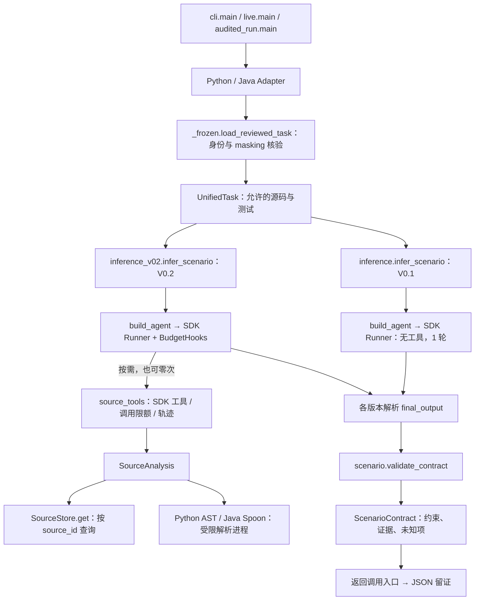

# Scenario Agent 架构导读

[项目入口](../README.md) · [运行命令](usage.md) · [输出字段](scenario-inference.md) · [研究与历史](README.md)

## 先认识四个文件

理解 V0.2 时先读这四处，暂时不需要阅读实验脚本和账本：

| 阅读顺序 | 文件及位置 | 回答的问题 |
| --- | --- | --- |
| 1 | [scenario_v0.2.txt](../src/mock_spec/prompts/scenario_v0.2.txt) | 要模型从输入推导什么？如何表达条件、替代解释和未知项？ |
| 2 | [scenario.py](../src/mock_spec/scenario.py)：`ScenarioContract` | 最终交付哪些约束和证据？ |
| 3 | [inference_v02.py](../src/mock_spec/inference_v02.py)：`build_agent`、`infer_scenario` | 如何组装并运行模型、Prompt、工具和输出类型？ |
| 4 | [source_analysis.py](../src/mock_spec/source_analysis.py)：`SourceAnalysis` | 模型需要更多证据时能查什么？ |

这里的 Agent 是“模型 + Prompt + 只读工具 + 结构化输出”。
Python 宿主负责运行和验证；场景推导主要由模型完成，并没有一套完整的确定性推导算法。

V0.2 的代码职责现在按下面的关系组织；先读中间的推断入口，需要细节时再向两侧展开：

```text
budget.py                  inference_v02.py               source_tools.py
预算定义、用量和门禁  ←  加载 Prompt → 组装 → 运行 → 校验  →  三个 SDK 工具及任务级轨迹
                                                              ↓
                                                        source_analysis.py
                                                        可见源码与语法事实
```

`source_tools.build_source_tools` 接收本次运行的 `SourceStore`，在 SDK 参数解析前登记原始请求、
响应关联及失败；它不负责推断。默认片段模式保留原调用限额。显式仓库读取模式不设固定工具或
SDK 轮数上限，由运行超时与共享用量账本停止。
`InferenceBudget` 定义在 `budget.py`，原 `inference_v02.InferenceBudget` 导入仍可用。

## 一次输入如何流动



图中入口按版本选择其中一条推断路径，不会同时调用两版。
`cli --response-json` 是另一条明确的离线分支：Adapter → 契约校验 → synthetic_replay，绕过模型。

1. **输入审核**：宿主提供 snapshot 和 case ID。Adapter 检查已安装准入记录、文件身份和 masking，产出 `UnifiedTask`。
2. **推断**：`infer_scenario` 将 `task.to_dict()` 作为初始输入。`build_agent` 配置对应 Prompt、模型、工具与 `output_type=ScenarioContract`。
3. **工具查询**：V0.2 可以查询原文、程序结构和依赖使用。默认工具分析当前任务可见片段；仓库读取模式允许 `inspect_source` 的 `source_id` 参数
   使用初始逻辑路径或已发现路径读取更多行，返回稳定的动态 source_id。
   `inspect_source` 的 `search` 操作在宿主绑定的冻结项目内按相对路径模式/字面文本发现文件，
   生产 SDK 和研究 QueryExecutor 使用同一参数校验与 SourceAnalysis/SourceStore 实现。
   搜索只登记实际返回的完整匹配行，路径发现与内部读取不授权全文引用。分析失败或未解析状态保留。
   两个分析工具共用 `source_id` 与可选 `symbol` 协议；初始 ID 分析原片段，已发现 ID/路径
   经 Store 内部有界读取完整文件后复用 AST/Spoon。定义与使用位置按精度分类，名称匹配不等于目标解析。
   仓库模式分析不返回引用原文或登记 observed，需显式读取对应行后才能引用。
4. **输出验证**：模型返回候选契约；宿主使用同一运行 Store 检查结构、任务身份、初始或实际观察引用、源码行范围和原文。引用存在不意味着结论成立。
5. **保存结果**：CLI 写简单 JSON；完整审计入口额外保存身份、原始响应、轨迹、用量和失败状态。

## 文件地图

这些是现有文件的职责分组，不是新增的目录或调用层级。

| 职责 | 现有文件 | 何时阅读 |
| --- | --- | --- |
| 审核输入 | [adapters/](../src/mock_spec/adapters/)、[schemas.py](../src/mock_spec/schemas.py)、[validation.py](../src/mock_spec/validation.py)、[reviewed_inputs.json](../src/mock_spec/reviewed_inputs.json) | 修改输入准入、源码范围或 SourceStore 时 |
| Agent 核心 | [inference.py](../src/mock_spec/inference.py)、[inference_v02.py](../src/mock_spec/inference_v02.py)、[prompts/](../src/mock_spec/prompts/)、[scenario.py](../src/mock_spec/scenario.py) | 理解或修改场景推断与输出处理时 |
| SDK 工具接入 | [source_tools.py](../src/mock_spec/source_tools.py) | 核对模型可见工具定义、任务级调用限额、轨迹与取消行为时 |
| 宿主文件绑定 | [source_repository.py](../src/mock_spec/source_repository.py) | 描述符相对读取、有界搜索、访问策略、分页及文件身份核验；绑定不进入 UnifiedTask |
| 源码工具 | [source_analysis.py](../src/mock_spec/source_analysis.py)、[python_analysis.py](../src/mock_spec/python_analysis.py)、[java_analysis.py](../src/mock_spec/java_analysis.py) | 核对可见源码与语法事实时 |
| 解析进程 | [analysis_process.py](../src/mock_spec/analysis_process.py)、[python_analysis_runner.py](../src/mock_spec/python_analysis_runner.py)、[tools/](../src/mock_spec/tools/) | 检查超时、取消、隔离与 Java helper 时 |
| 运行入口 | [cli.py](../src/mock_spec/cli.py)、[live.py](../src/mock_spec/live.py)、[audited_run.py](../src/mock_spec/audited_run.py) | 启动推断或选择留证方式时 |
| 执行元数据 | [execution_metadata.py](../src/mock_spec/execution_metadata.py) | 核对代码版本、指纹、运行环境及不可用状态时 |
| 预算与留证 | [budget.py](../src/mock_spec/budget.py)、[experiment_ledger.py](../src/mock_spec/experiment_ledger.py)、[run_evidence.py](../src/mock_spec/run_evidence.py) | 核对预算门禁、实验尝试和结果写入时 |

`execution_metadata.collect_execution_metadata` 统一采集代码版本、文件指纹与运行环境；
审计入口和离线验证脚本都使用这个接口，不再从运行入口导入私有函数。
它不负责推断或写入证据，输出字段由调用者映射到各自已有格式。

`audited_run.main` 在正式运行前登记尝试，推断后交给 `run_evidence.finish_run`。
有账本时先写 pending 证据，再完成账本，最后发布结果；失败时保留可得证据。
这些是宿主的运行管理，不是模型的推断步骤。

V0.2 用 `InferenceTimeoutError` 区分宿主总超时与其他预算耗尽；它仍继承共享
`InferenceError`，保留原 `category` 与 `diagnostic`。`audited_run` 将超时事实交给
`finish_run` 决定账本 outcome，结果 JSON 的原有字段不增加、不改义。
V0.1 的冻结异常没有这个类型，历史文案识别只保留在审计入口的 V0.1 分支。
留证 module 不再根据异常文字分类，也不依赖具体版本的推断实现。

完整实现身份记录在 `code_files_sha256`，包含工具注册模块；`code_sha256` 仅标识所选推断入口文件。
代码整理会改变正式运行的配置摘要，不能沿用旧账本伪装为同一实验，也不改写历史证据。

`live_v02.py` 仅保留 `main` 和模块命令兼容，供历史 Step 6 协议引用；当前入口是
`audited_run.py`。历史复现引用仍存在期间保留旧命令，不在兼容文件中添加实现。

## 版本与入口

| 入口 | 版本 | 用途 |
| --- | --- | --- |
| `mock-spec-scenario` / `python -m mock_spec.cli` | 默认 V0.1，可显式 V0.2 | 普通推断或显式离线回放 |
| `python -m mock_spec.audited_run` | 必须显式选择 V0.1 / V0.2 | 完整留证，区分 standalone 与正式实验账本 |
| `python -m mock_spec.live` | 仅 V0.1 | 保留早期留证协议与复现命令 |

V0.1 无工具，V0.2 有三个只读工具；两版都使用正式 ScenarioContract。
[Step 6 已确认的约定](step6/decisions.md#保留与范围)要求 V0.1 核心逐字冻结，
因此两版之间少量重复处理是保留基线的代价，不能把 `inference.py` 当成死代码删除。
旧入口仍有测试和历史复现用途。V0.1 保持冻结；V0.2 入口和预算的兼容导入保留，
内部预算定义与工具注册已按职责迁移，不再在推断入口重复保留实现。

## 命名迁移与保留的依赖

当前 `source_tools.build_source_tools` 负责 SDK 工具注册、调用限额、轨迹与取消；
`source_analysis.SourceAnalysis` 负责审核源码访问、解析后端选择与结果限长，不依赖 Agent SDK。
两个解析 adapter 的共同结果在这里校验：状态、facts 及其 kind、诊断和限制说明必须具有合法形状，
结果须能序列化为 JSON；任一共同字段畸形都整份返回 `analysis_error`，不保留部分 facts。
语言特有字段和正常诊断内容保留；取消仍向上传播，语法 incomplete/unresolved 不转为成功。
原 `agent_tools.py`、`program_tools.py` 的活动调用者已迁移，旧模块不再保留；
历史报告中的路径和哈希仍描述当时版本，复现历史版本需使用其记录的提交。
模型可见的三个 `inspect_*` 工具名称保持不变；`inspect_source` 支持显式 search/read，
原三参数读取仍兼容。畸形后端结果在两个分析查询中一致失败。

尚保留一项跨版本耦合：V0.2、预算、SDK 工具和运行留证使用冻结
`inference.py` 定义的 `InferenceError`，以保持同一个异常类型及捕获行为。
这使这些模块仍依赖 V0.1 模块；另建转发文件不能消除依赖。
待 V0.1 冻结约定允许调整公共错误归属时，再一起迁移定义、生产者和捕获者，
验证类型兼容及失败分类；本轮不修改冻结文件。

## 研究路径

`experiments/staged-inference/` 承接 [M1-1 / #7](https://github.com/Haon0731/Mockspec/issues/7)
、[M1-2 / #8](https://github.com/Haon0731/Mockspec/issues/8)
、[M1-3 / #9](https://github.com/Haon0731/Mockspec/issues/9)
及 [M1-4 / #10](https://github.com/Haon0731/Mockspec/issues/10) 的 B/C 变体离线回放：合成 Python `UnifiedTask` → 同一研究控制器的
EXTRACT → QUERY（零至六次定向查询）→ CONSTRUCT → CONTRAST（仅 C）→
REVISE（可选一次）→ DELIVER → FORMAT_REPAIR（可选一次）→ 契约、研究记录与运行清单。
固定脚本模型仍经过 Agents SDK Runner；控制器复用生产 `UsageLedger`、
`validate_contract`（含 `SourceStore` 原文校验）及运行身份采集组件。
研究阶段协议、Prompt 与产物写入位于研究目录，生产包不反向依赖它。
M1-5 的 `acceptance.py` 汇总同一入口的固定回放并复核产物；`run.py` 的
`live_inference` 分支通过现有 Python Adapter 加载获准的 flask_308，再交给同一控制器。
真实配置缺失时只记录预检缺口，不将固定模型或合成任务标为真实检查。
`query.py` 的运行级 `QueryExecutor` 在参数解析前登记请求，再分派到既有
`SourceAnalysis`；旧片段模式的三种工具及失败、重试共用六次额度，第七次留拒绝回执且不执行分析。
显式仓库读取模式改为共享超时、Token 与费用门禁，不以工具或模型调用次数截断；
QueryExecutor 和各阶段契约检查共用本次 Store，观察记录随研究产物保存。
模型经 QUERY 结构化消息请求工具，SDK 阶段 Agent 不注册可绕过计数的工具。
后续 QUERY 评估上一回执，CONSTRUCT/DELIVER 接收累计回执；未完成判断明确留证。
阶段切换和 SDK 对象重建不重置账本、模型请求数、查询数或绝对截止时间。

宿主在输入加载/校验前登记运行身份和独立输出目录，校验后保存确定性输入快照；
请求前检查显式配置与整次运行的预算。输入拒绝保留请求身份，有效任务身份与哈希为 null。
模型只接收完整可见任务及阶段上下文，宿主配置、物理输入目录和评价材料不进入初始输入。
DELIVER 本地校验选择、引用及任务身份后，先写契约与记录，再写含实际文件哈希的清单；
SELECTED 与 AMBIGUOUS 必须有有效契约；INCONCLUSIVE 可保留完整契约供诊断；
ERROR 只保留阶段草案与错误，不发布最终契约。状态与停止原因分别保存；已有输出目录拒绝覆盖。
正式 `ScenarioContract` 保持 v0.1 字段；研究选择状态、运行身份和对照状态由旁路记录承载。

C 的静态对照与一次语义修订由控制器管理，前后快照留在研究记录；B 仅关闭对照。
修订不能改原目标，候选上限为二，之后不能重开查询。最终格式修复与语义修订单独计数，
先建立与已验证构造一致的完整语义快照，再允许一次共享预算请求；修复不得改变证据来源、
范围或原文，不能建立快照或修复失败时不发布契约。

这条路径验证 B/C 四状态流程、静态对照、修订修复、定向查询、共享预算及失败留证边界；
合成任务不经过真实 Adapter 审核，不构成真实数据准入、目标测试执行或模型推断质量证据。
M1-5 的入口验收与真实检查缺口见[验收记录](../experiments/staged-inference/acceptance-report.md)；用法及预算见[运行说明](usage.md#分阶段研究回放m1-1--m1-4)。

```text
experiments/scenario-research/
  run_local.py → LocalResearchHost → local_patterns → 现有 AST/Spoon
               → local_solver → 隔离 cvc5 worker → 局部检查记录
  models.py / build_examples.py / poc.py → 人工模型与研究草案回归

experiments/dependency-witness/
  run_witness.py → 人工候选 → 冻结 injector → 隔离 pytest
                → witness_observer → 宿主核验执行事实
```

这两条路径没有接入生产 Scenario Agent。源码局部检查不调用人工 `models.py`
获得答案；人工见证不是 Agent 自动生成结果。历史分析试验位于 `docs/step5a/poc/`
和 `docs/step5b/poc/`，只在相应复现流程中使用，不属于生产工具运行链路。
研究协议、范围与结果从 [文档目录](README.md) 查阅。

## 验证能说明什么

- 输入与契约测试保护准入、字段、引用和原文匹配。
- 脚本模型通过 SDK 的测试保护运行链路，不证明真实模型自主选择工具或推断正确。
- AST/Spoon 测试保护语法事实与进程行为，不证明路径可行性。
- cvc5 研究只检查记录的局部模型；人工见证只验证指定候选和参数行。
- 场景推导质量与工程验收分别判定，参见 [术语表](../GLOSSARY.md)。

测试命令与真实数据读取范围见 [运行与开发](usage.md)。
